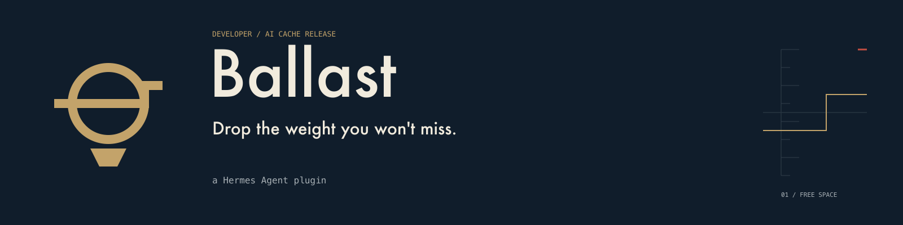

<p align="center"></p>

# Ballast

Ballast is a Hermes Agent plugin for macOS. You tell Hermes how much disk space you need ("I need 15 GB"), and Ballast frees it by clearing the developer and AI caches you'll miss least: package manager caches, build caches, downloaded model weights. Nothing outside its list of known, rebuildable caches is ever touched.

Demo video: _link coming soon_

## How it works

1. **Scan.** Ballast measures the caches it knows about (npm, pnpm, pip, uv, Go, Hugging Face models and others; the full list is in `plugin/ballast/registry.py`). Anything not on that list is ignored.
2. **Plan.** It picks the smallest set that reaches your target, ranked by how painful each cache is to get back: mostly re-download size and rebuild time. If the target can't be reached, it says so and tells you how short you are instead of reaching for things it shouldn't.
3. **Approve.** Deleting anything goes through Hermes's own approval prompt. The prompt shows the exact paths and byte counts. Plans are signed and expire after 15 minutes, so an old plan can't be replayed.
4. **Clean.** Where a tool has its own clean command (`npm cache clean --force`, `pip cache purge`, `uv cache clean`), Ballast runs that first. If there isn't one, or it fails, it deletes the cache contents directly, scoped to the approved paths. This is real deletion, not a trash folder.
5. **Receipt.** Every run is written to a ledger along with a rebuild recipe: the commands that bring each cache back (`npm install`, `uv sync`, re-pulling a model).

## Install

Requires Hermes `>=0.23.0` on macOS.

```sh
hermes plugins install ballast   # once it's listed in the catalog
hermes plugins enable ballast
```

## Usage

Talk to Hermes normally:

- "I need 10 GB for a model download. Don't touch the model I'm using."
- "Go ahead and apply that plan."
- "Show me the rebuild recipe."

Or use the slash command: `/ballast 15 GB` builds a plan. `/ballast {"action": "scan", "args": {}}` runs any other tool as a preview. Slash commands never delete anything; real cleanup only happens through an approved `ballast_apply` tool call.

Tools: `ballast_scan`, `ballast_plan`, `ballast_apply`, `ballast_ledger`, `ballast_status`. Hooks: `pre_tool_call`, `pre_approval_request`, `post_approval_response`. A Desktop page shows the waterline (free space before and after) using only the plugin SDK.

## Safety and disclosure

- **Approval first.** Nothing is deleted without a fresh Hermes approval for that exact plan. Ballast never auto-approves and never runs under YOLO or non-interactive mode.
- **Real deletion.** Approved caches are gone. They can be rebuilt, but that costs download time and bandwidth.
- **Files it reads.** Cache directories under your home folder (sizes and access times only), plus its own data in the Hermes plugin data directory. It refuses system folders, personal folders (Documents, Desktop, Photos and the like) and Hermes's own home.
- **Commands it runs.** Only the tool clean commands listed in `registry.py`. They run offline with a minimal environment and a private, empty config.
- **Network.** None. No telemetry, no update checks, no downloads. No binaries are shipped.
- **Credentials.** None read or stored.

The `scan_home` setting points Ballast at a different folder you own, which is useful for demos and tests. When it's set, every scan and plan says `Scanning: <path>`.

## Development

```sh
python3 scripts/verify.py    # unit tests, Desktop checks, plugin validate and doctor
```

Tests use fake home directories and never touch your real caches.

## License

MIT. Made by [1momoh](https://github.com/1momoh).
